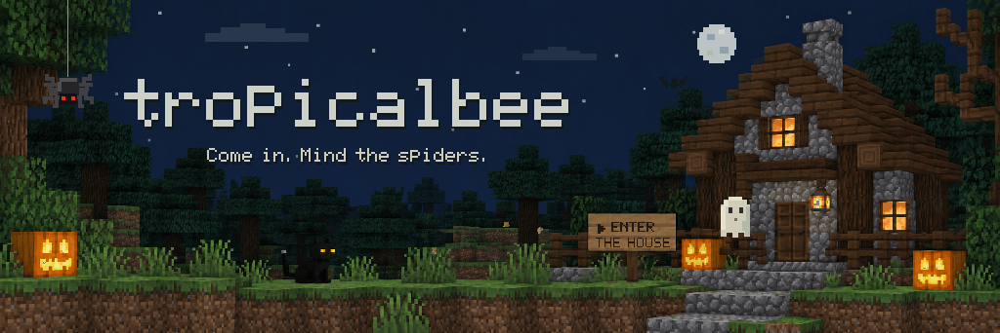
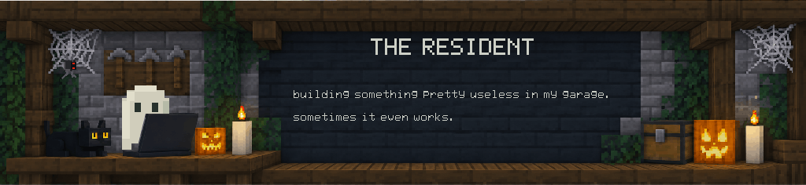
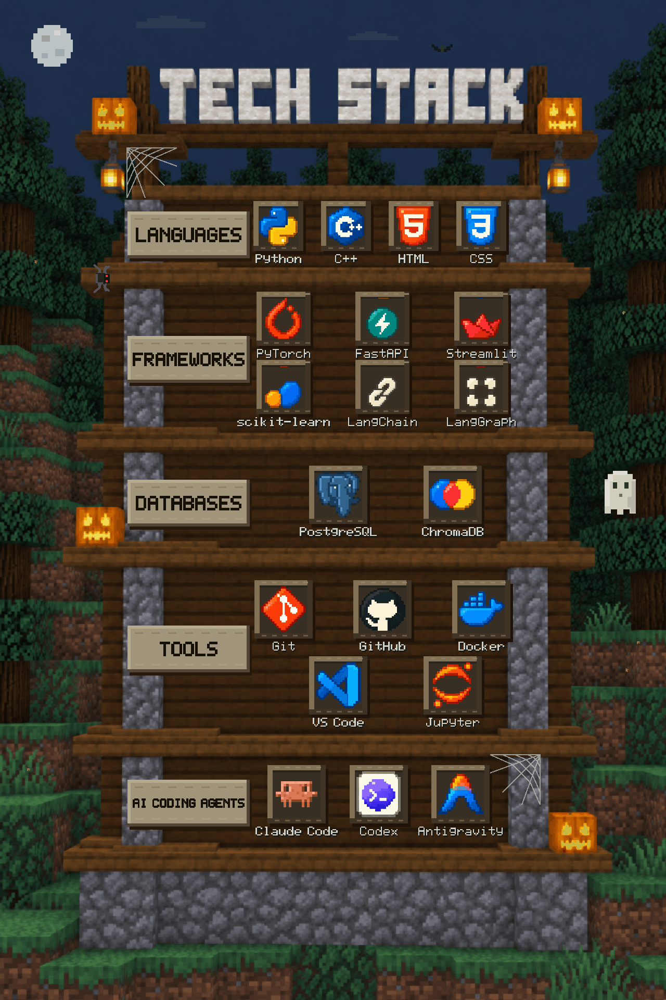
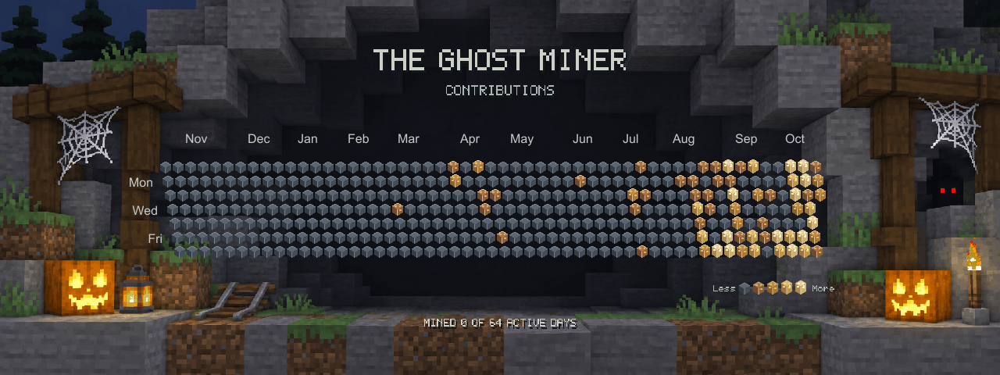
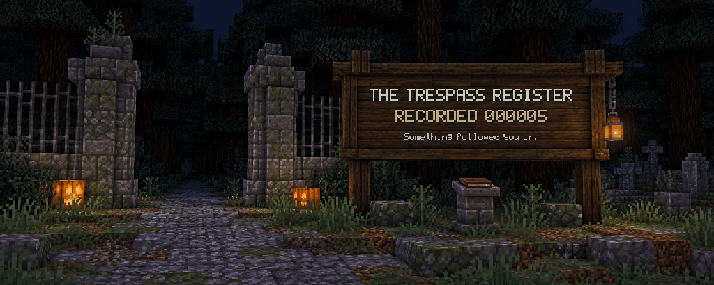

<!-- Keep the six kit folders beside this file in tropicalbee/tropicalbee. -->

<!-- Keep this stack free of paragraphs and blank lines between sections. -->

  <a href="tropicalbee-halloween-banner-kit/game/start.md" title="Enter the House — play the adventure">
    <picture>
      <source media="(prefers-reduced-motion: reduce)" srcset="tropicalbee-halloween-banner-kit/assets/tropicalbee-halloween-preview.png">
      
    </picture>
  </a>

  <picture>
    <source media="(prefers-reduced-motion: reduce)" srcset="resident-section-kit/assets/resident-preview.png">
    
  </picture>

  <picture>
    <source media="(prefers-reduced-motion: reduce)" srcset="tech-stack-kit/assets/tech-stack-preview.png">
    
  </picture>

  <a href="https://github.com/tropicalbee?tab=repositories">
    <picture>
      <source media="(prefers-reduced-motion: reduce)" srcset="garage-section-kit/assets/garage-brewing-preview.png">
      
    </picture>
  </a>

  <a href="https://github.com/tropicalbee?tab=overview">
    <picture>
      <source media="(prefers-reduced-motion: reduce)" srcset="ghost-miner-kit/assets/ghost-miner-preview.png">
      
    </picture>
  </a>

  <picture>
    <source media="(prefers-reduced-motion: reduce)" srcset="trespass-section-kit/assets/trespass-register-preview.png">
    
  </picture>
  

  <a href="https://github.com/tropicalbee?tab=repositories">Explore my repositories</a>

  
Read the profile as text

  
<strong>Hi, I'm tropicalbee.</strong> Come in. Mind the spiders.

  
building something pretty useless in my garage. sometimes it even works.

  <ul>
    <li><strong>Languages:</strong> Python, C++, HTML, CSS.</li>
    <li><strong>Frameworks:</strong> PyTorch, FastAPI, Streamlit, scikit-learn, LangChain, LangGraph.</li>
    <li><strong>Databases:</strong> Firebase, ChromaDB, Supabase.</li>
    <li><strong>Tools:</strong> Git, GitHub, Docker, VS Code, Jupyter.</li>
    <li><strong>AI assistants:</strong> Codex, Antigravity.</li>
  </ul>
  
<strong>Projects:</strong> still brewing in my garage..

  
<strong>The Trespass Register:</strong> an abandoned cemetery checkpoint. Footprints approach the entrance although nobody is visible. The wooden sign records profile-view requests, not unique visitors. Its saved count refreshes at midnight and noon India time. An invisible counter image records requests between updates.

  
<strong>The Ghost Miner:</strong> a nightly snapshot of my public GitHub contribution calendar. Slate is an inactive day; copper and amber mark activity. The ghost mines each active day once before the loop resets.

  
<strong>The house:</strong> click the signboard in the entrance banner to play The Thirteenth Knock. Every Halloween, Briar House returns to steal another name. Explore two chapters, solve seven puzzles, and uncover six endings as you discover what its caretaker invited inside.

