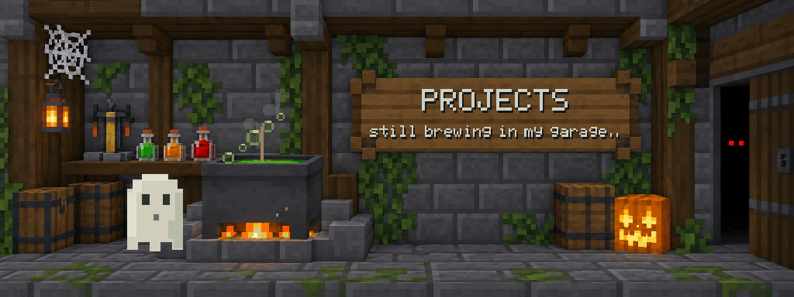

# Haunted garage · brewing section

A Minecraft Halloween README section for work in progress. The sign has a large heading and a smaller status:

> PROJECTS
>
> still brewing in my garage..

The brewer floats and blinks, a spoon stirs, and potion bubbles, steam and embers rise while the fire and pumpkin face flicker. The room and lettering stay still.



## Add it to a profile README

Copy `assets/garage-brewing.gif` into your profile repository, then use:

```md

```

This section works as a projects placeholder. Edit the two lines when you have something you want to share.

## Customize

Edit `garage-config.json`. The first line is the large section heading; the second is the smaller status. Shorter text remains easier to read. `textColor` changes the lettering. The animation switches control potion bubbles, fire cores and the pumpkin face independently.

The assets include a GIF for README use, an animated SVG, a static SVG and a PNG preview. The SVG supports reduced motion where the viewer supports that preference. The GIF is the simplest portable animation.

## Render

Requires Node.js and the `sharp` package. Retain the repository's shared `scripts/` folder and `resident-section-kit/source/ghost-sprite.mjs`:

```sh
npm install
npm run render
```

For a PNG and SVG preview without rendering GIF frames:

```sh
node source/render-garage.mjs --preview
```

No API key is needed to re-render or change the text. The generated background is included. The renderer keeps intermediate frames under `build/` and writes finished assets to `assets/`.

## Source and reuse

The background was edited with the built-in image-generation tool; lettering and animation are editable code. Art direction is recorded in `source/art-direction.md`. Code is MIT licensed. This is an unofficial community design and is not affiliated with Minecraft or Mojang.
