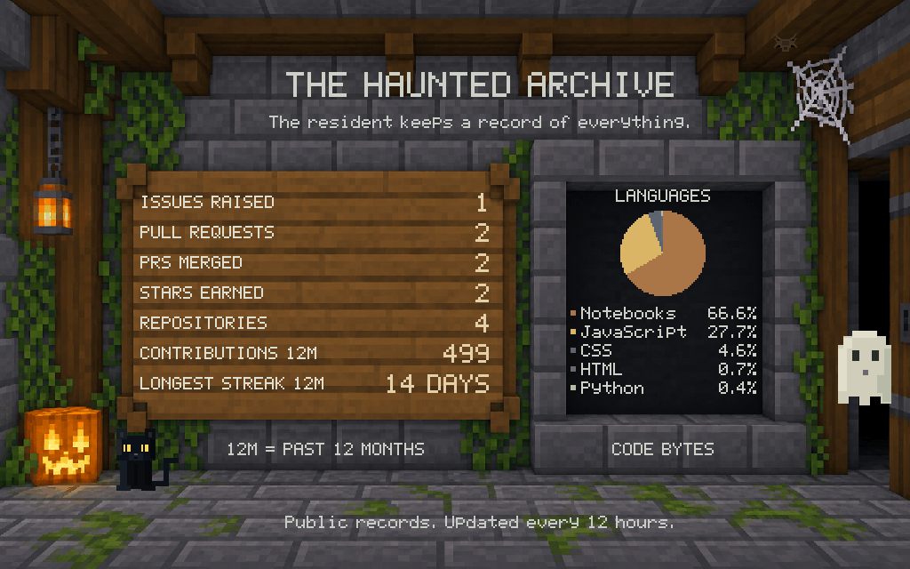

# The Haunted Archive



[Read the latest numbers and language percentages as text](assets/stats-summary.md).

This section sits between the brewing garage and the Ghost Miner. It shares
their coarse grey stone, oak, moss and copper palette. The animated GIF is 1024 by
640, with 100 frames over eight seconds. The PNG is the reduced-motion fallback;
the SVG is an editable still. Labels and the chart remain still while the beam
spider, resident ghost, black cat, lantern core and doorway eyes animate. The ghost
uses the same sprite as the Resident section and floats freely by the doorway.
The cat stays seated beside the pumpkin, blinking, shifting its gaze and moving
its anchored tail. Both are small native vector sprites; no additional raster
asset is loaded. The archive cat uses near-black fur, subtle blue-black edge
shading and bright yellow eyes based on the cat in the Resident artwork. It is
an animated vector interpretation; the Resident cat is baked into its backdrop.
All lettering
uses integer pixel sizes of at least 2, with no blurred or offset shadow. The
chart uses the copper, gold, stone and moss colours of the adjacent mine.
"Notebooks" on the chart refers to GitHub's Jupyter Notebook category; full names
appear in the linked text summary.

## What the numbers mean

| Metric | Scope |
| --- | --- |
| Issues raised | Public issues authored by tropicalbee, open or closed |
| Pull requests | Public PRs authored by tropicalbee, all states |
| PRs merged | Authored public PRs that have been merged |
| Stars earned | Current stars across owned public non-fork repositories |
| Repositories | Owned public non-fork repositories, including archived ones |
| Contributions | Sum of GitHub profile calendar counts in the past 12 months |
| Longest streak | Most consecutive active calendar days within that same window |

The language chart aggregates GitHub's detected byte counts across owned public
non-fork repositories. `stats-config.json` excludes the profile repository from
the chart so generated assets do not dominate it. This exclusion does not remove
that repository from the star/repository totals. Jupyter Notebook remains its
own GitHub language category. These are code shares, not proficiency, framework
usage or proof of individual authorship. The largest five languages are shown;
any remaining languages are combined as Other. Displayed percentages sum to 100.0.

The contribution period is exactly twelve calendar months ending on the latest
date returned by GitHub. Streaks use GitHub calendar dates and reset on zero-count
days. They are not lifetime streaks. The publicly visible calendar may include
anonymous private activity if the account owner enabled that GitHub setting.

## Refresh and render

The existing workflow fetches and renders this section at midnight and noon
Asia/Kolkata. Public REST requests use its built-in GITHUB_TOKEN. No personal
token, deployment, hosted card service or new dependency is required. A failed,
incomplete or malformed response does not replace the previous data. Repository
pagination is checked. Zero is a real result; unavailable data is never turned
into zero. API outages or limits fail the job and preserve published images.

For a manual fetch, the following command needs network access. GITHUB_TOKEN is
optional locally; unauthenticated API limits can be reached with many repositories.

```sh
python -B stats-section-kit/source/fetch-stats.py
```

Render the saved snapshot offline using the shared Sharp installation:

```sh
node stats-section-kit/source/render-stats.mjs
```

Keep `scripts/`, the garage pixel font, and the miner calendar parser with this kit.
The background is generated Minecraft-inspired artwork, not an actual game
screenshot. The exact generation prompt is in `source/art-prompt-v2.json`.

Sources: [GitHub repository/language API](https://docs.github.com/en/rest/repos/repos#list-repository-languages),
[GitHub issue/PR search API](https://docs.github.com/en/rest/search/search#search-issues-and-pull-requests),
and the account's public profile calendar.
