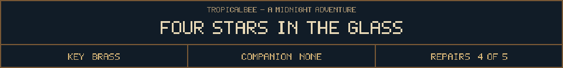

<!-- Generated by source/render-adventure.mjs. Edit source/adventure.mjs or source/adventure-expansion.mjs. -->

<strong>Sky bearing recorded. Restore the beacon.</strong>

<small><strong>Inventory:</strong> Brass key &middot; Moonseed &middot; Copper coil &middot; Star lantern &middot; Sky bearing</small>

The diamond settles into the lens. One path through the trees straightens. Along it, the pumpkin mouths begin whispering their names together.

You lock the bearing ring. Three catches wait on the beacon pedestal. Downstairs, the twelfth knock falls.

The final instruction card lies beneath the catches. Mother Hollow cannot make the thirteenth without an answer. You have time to read.

  
  

House map and ward journal

<strong>House:</strong> Foyer &rarr; Study &rarr; Attic &rarr; Garden.

<strong>Beyond the garden:</strong> Greenhouse &rarr; Cellar &rarr; Workshop &rarr; Observatory.

Leave through the garden for a shorter ending, or follow the lanterns to restore the ward and free the stolen names. Backtracking preserves your inventory; Restart starts over.

<ol><li>Briar House steals names every Halloween. Elias left a broken beacon ward; restoring it can release the names.</li><li>Moon water opens the silver flower. Its moonseed reveals things the haunting conceals.</li><li>Pump fuse order: amber before blue, blue before green. The dry cabinet holds the copper coil.</li><li>Lantern circuit: socket receives the seed, gear draws the current, prism sends the light outward.</li><li>The four-star diamond points north. The observatory bearing is now recorded.</li></ol>

  <a href="start.md">Restart adventure</a>
  &nbsp;&middot;&nbsp;
  <a href="../../README.md">Return to profile</a>

Progress travels with this page. Bookmark it to resume. Restart begins a new run.

