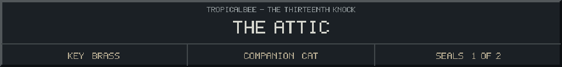

<!-- Generated by source/render-adventure.mjs. Edit source/adventure.mjs or source/adventure-expansion.mjs. -->

<strong>Find the song that opens the garden exit.</strong>

The attic smells of burnt sugar. Three bells guard the garden exit: snowflake, sun and leaf. Elias sets a saucer beside two cups.

Your cat refuses the saucer. In its reflection, someone very tall is standing behind your chair. The space itself is empty.

&quot;A little warmth before you go,&quot; Elias says. Beneath the table, his hand points urgently toward the bells.

  
  
  

House map

<strong>House:</strong> Foyer &rarr; Study &rarr; Attic &rarr; Garden.

<strong>Beyond the garden:</strong> Greenhouse &rarr; Cellar &rarr; Workshop &rarr; Observatory.

Leave through the garden for a shorter ending, or follow the lanterns to restore the ward and free the stolen names. Backtracking preserves your inventory; Restart starts over.

Find the brass key and solve the two house locks to reach the garden.

  <a href="start.md">Restart adventure</a>
  &nbsp;&middot;&nbsp;
  <a href="../../README.md">Return to profile</a>

Progress travels with this page. Bookmark it to resume. Restart begins a new run.

