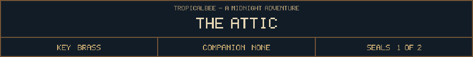
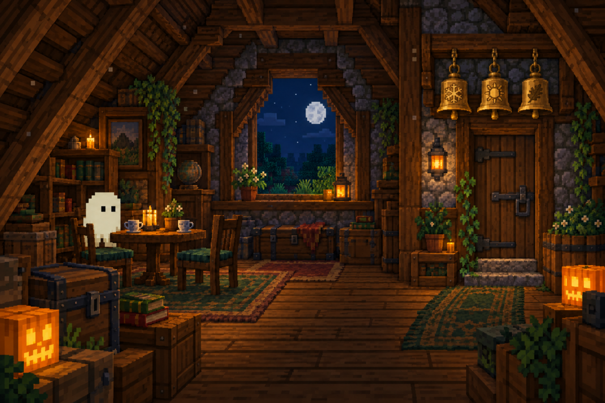
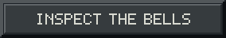

<!-- Generated by source/render-adventure.mjs. Edit source/adventure.mjs or source/adventure-expansion.mjs. -->

<strong>Find the song that opens the garden exit.</strong>

The brass key fits. Beyond the door, a steep-roofed attic smells of cedar and tea.

Three bells hang over a second door: snowflake, sun and leaf. Beside them the ghost has set out two cups.

&quot;The garden is through there,&quot; it says. &quot;But you are very welcome to stay.&quot;

  
  
  

House map

<strong>House:</strong> Foyer &rarr; Study &rarr; Attic &rarr; Garden.

<strong>Beyond the garden:</strong> Greenhouse &rarr; Cellar &rarr; Workshop &rarr; Observatory.

The garden offers a shorter ending or the longer repair quest. Backtracking choices preserve your current inventory; Restart starts over.

Find the brass key and solve the two house locks to reach the garden.

  <a href="start.md">Restart adventure</a>
  &nbsp;&middot;&nbsp;
  <a href="../../README.md">Return to profile</a>

Progress travels with this page. Bookmark it to resume. Restart begins a new run.

