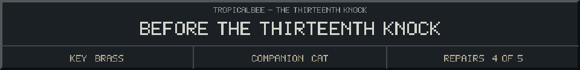

<!-- Generated by source/render-adventure.mjs. Edit source/adventure.mjs or source/adventure-expansion.mjs. -->

<strong>Puzzle 07 - restore the ward without answering her.</strong>

<small><strong>Inventory:</strong> Brass key &middot; Moonseed &middot; Copper coil &middot; Star lantern &middot; Sky bearing &middot; Black cat companion</small>

Your hands rest on the three catches: seed, coil, lantern. The sky bearing is locked in place.

From below, Ada calls for her father. Elias says nothing. Choose the startup sequence; let the light answer.

  
  
  

Need a hint?

Follow the commissioning card exactly: seed, coil, lantern.

House map and ward journal

<strong>House:</strong> Foyer &rarr; Study &rarr; Attic &rarr; Garden.

<strong>Beyond the garden:</strong> Greenhouse &rarr; Cellar &rarr; Workshop &rarr; Observatory.

Leave through the garden for a shorter ending, or follow the lanterns to restore the ward and free the stolen names. Backtracking preserves your inventory; Restart starts over.

<ol><li>Briar House steals names every Halloween. Elias left a broken beacon ward; restoring it can release the names.</li><li>Moon water opens the silver flower. Its moonseed reveals things the haunting conceals.</li><li>Pump fuse order: amber before blue, blue before green. The dry cabinet holds the copper coil.</li><li>Lantern circuit: socket receives the seed, gear draws the current, prism sends the light outward.</li><li>The four-star diamond points north. The observatory bearing is now recorded.</li></ol>

  <a href="start.md">Restart adventure</a>
  &nbsp;&middot;&nbsp;
  <a href="../../README.md">Return to profile</a>

Progress travels with this page. Bookmark it to resume. Restart begins a new run.

