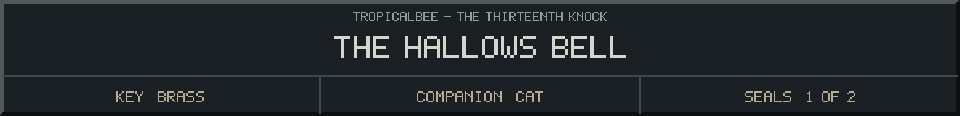
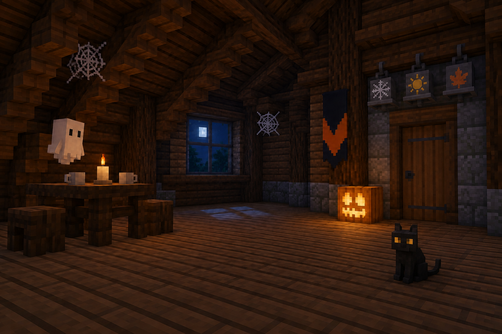
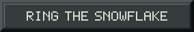
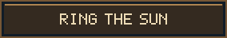
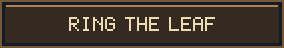

<!-- Generated by source/render-adventure.mjs. Edit source/adventure.mjs or source/adventure-expansion.mjs. -->

<strong>Ring the season that opens the Halloween threshold.</strong>

Beneath the bells, Elias has scratched a verse into the door:

&quot;When harvest ends and masks are worn, the borrowed dead walk until morn. Before the snow, beyond the sun, ring falling leaves and let me run.&quot;

Snowflake, sun or leaf? Your cat claws at an oak leaf beneath the door. The saucer slides across the floor toward it.

  
  
  

Need a hint?

Think of the season when oak leaves fall and pumpkins are carved. Ring the leaf bell.

House map

<strong>House:</strong> Foyer &rarr; Study &rarr; Attic &rarr; Garden.

<strong>Beyond the garden:</strong> Greenhouse &rarr; Cellar &rarr; Workshop &rarr; Observatory.

Leave through the garden for a shorter ending, or follow the lanterns to restore the ward and free the stolen names. Backtracking preserves your inventory; Restart starts over.

Find the brass key and solve the two house locks to reach the garden.

  <a href="start.md">Restart adventure</a>
  &nbsp;&middot;&nbsp;
  <a href="../../README.md">Return to profile</a>

Progress travels with this page. Bookmark it to resume. Restart begins a new run.

