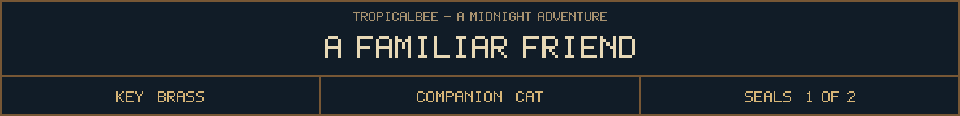
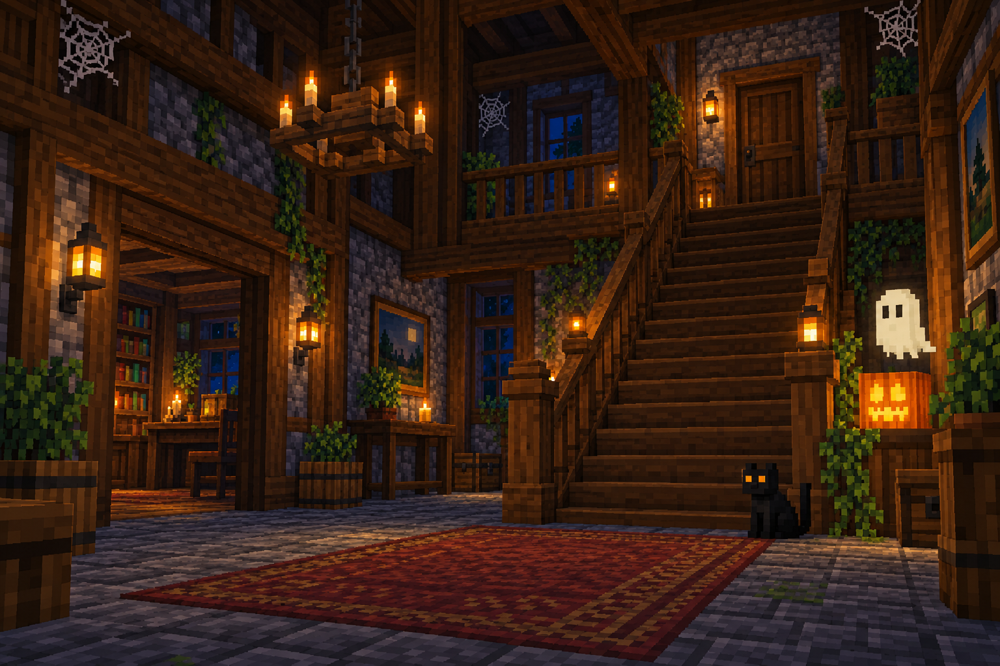
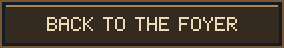

<!-- Generated by source/render-adventure.mjs. Edit source/adventure.mjs or source/adventure-expansion.mjs. -->

<strong>Companion found. Take your friend upstairs.</strong>

The cat catches the orange ribbon, gives the brass key one suspicious sniff, then hops onto your shoulder.

&quot;Excellent,&quot; says the ghost. &quot;You have been approved by management.&quot; Your new companion stays with you for the rest of this run.

  
  

House map

<strong>House:</strong> Foyer &rarr; Study &rarr; Attic &rarr; Garden.

<strong>Beyond the garden:</strong> Greenhouse &rarr; Cellar &rarr; Workshop &rarr; Observatory.

The garden offers a shorter ending or the longer repair quest. Backtracking choices preserve your current inventory; Restart starts over.

Find the brass key and solve the two house locks to reach the garden.

  <a href="start.md">Restart adventure</a>
  &nbsp;&middot;&nbsp;
  <a href="../../README.md">Return to profile</a>

Progress travels with this page. Bookmark it to resume. Restart begins a new run.

