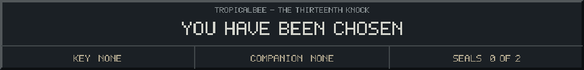
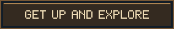

<!-- Generated by source/render-adventure.mjs. Edit source/adventure.mjs or source/adventure-expansion.mjs. -->

<strong>Ending 03 of 06 - The Familiar</strong>

You sit on the bottom step and offer a hand. The cat climbs into your lap, circles once, and falls asleep.

The ghost brings a blanket. The attic can wait. Apparently this is your home now.

THE FAMILIAR - You did not escape the house. You were adopted by it.

  

House map

<strong>House:</strong> Foyer &rarr; Study &rarr; Attic &rarr; Garden.

<strong>Beyond the garden:</strong> Greenhouse &rarr; Cellar &rarr; Workshop &rarr; Observatory.

The garden offers a shorter ending or the longer repair quest. Backtracking choices preserve your current inventory; Restart starts over.

Find the brass key and solve the two house locks to reach the garden.

  <a href="start.md">Restart adventure</a>
  &nbsp;&middot;&nbsp;
  <a href="../../README.md">Return to profile</a>
  &nbsp;&middot;&nbsp;
  <a href="endings.md">Ending collection (spoilers)</a>

Progress travels with this page. Bookmark it to resume. Restart begins a new run.

