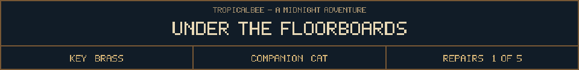
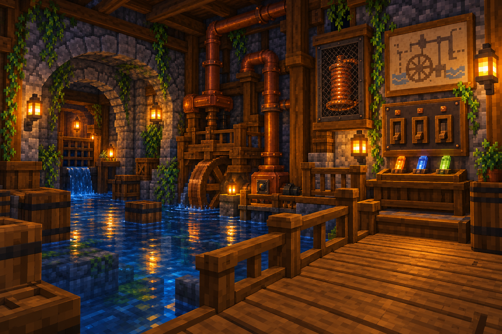

<!-- Generated by source/render-adventure.mjs. Edit source/adventure.mjs or source/adventure-expansion.mjs. -->

<strong>Restore the pump to reach the spare copper coil.</strong>

<small><strong>Inventory:</strong> Brass key &middot; Moonseed &middot; Black cat companion</small>

Shallow water covers the stone floor. A raised walkway leads safely to an idle pump.

The spare coil is behind a mesh cabinet across the wet section. Three loose fuses wait beside the control box.

Your cat settles on a dry barrel and supervises with extraordinary seriousness.

  
  
  

House map and repair journal

<strong>House:</strong> Foyer &rarr; Study &rarr; Attic &rarr; Garden.

<strong>Beyond the garden:</strong> Greenhouse &rarr; Cellar &rarr; Workshop &rarr; Observatory.

The garden offers a shorter ending or the longer repair quest. Backtracking choices preserve your current inventory; Restart starts over.

<ol><li>The old nightkeeper built a beacon to guide lost travellers. Its light has gone out.</li><li>The silver flower opens only to water that has caught moonlight. Its moonseed stores that light.</li></ol>

  <a href="start.md">Restart adventure</a>
  &nbsp;&middot;&nbsp;
  <a href="../../README.md">Return to profile</a>

Progress travels with this page. Bookmark it to resume. Restart begins a new run.

