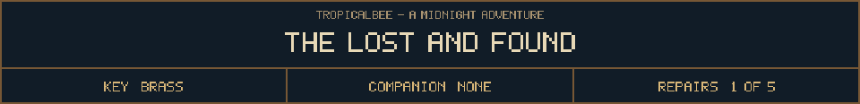
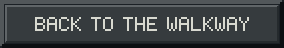

<!-- Generated by source/render-adventure.mjs. Edit source/adventure.mjs or source/adventure-expansion.mjs. -->

<strong>Discovery - the missing guests were never visitors by chance.</strong>

<small><strong>Inventory:</strong> Brass key &middot; Moonseed</small>

The shelf holds a paper crown, a cracked skull mask and a candy bag with Ada's name on it. None of the sweets have wrappers.

A register lists one Halloween after another. Beside every guest, the same phrase: &quot;Answered the door.&quot;

The newest entry describes your coat. Its space for a name is still blank. The brass key grows cold in your pocket.

  
  

House map and ward journal

<strong>House:</strong> Foyer &rarr; Study &rarr; Attic &rarr; Garden.

<strong>Beyond the garden:</strong> Greenhouse &rarr; Cellar &rarr; Workshop &rarr; Observatory.

Leave through the garden for a shorter ending, or follow the lanterns to restore the ward and free the stolen names. Backtracking preserves your inventory; Restart starts over.

<ol><li>Briar House steals names every Halloween. Elias left a broken beacon ward; restoring it can release the names.</li><li>Moon water opens the silver flower. Its moonseed reveals things the haunting conceals.</li></ol>

  <a href="start.md">Restart adventure</a>
  &nbsp;&middot;&nbsp;
  <a href="../../README.md">Return to profile</a>

Progress travels with this page. Bookmark it to resume. Restart begins a new run.

