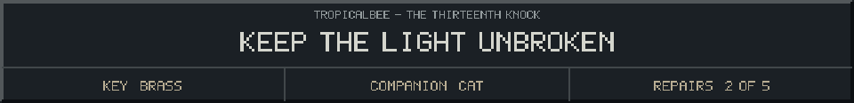

<!-- Generated by source/render-adventure.mjs. Edit source/adventure.mjs or source/adventure-expansion.mjs. -->

<strong>Puzzle 05 - connect receiver, current and light.</strong>

<small><strong>Inventory:</strong> Brass key &middot; Moonseed &middot; Copper coil &middot; Black cat companion</small>

Socket, gear, prism. Three parts and one continuous path.

Choose the order from the seed toward the beam. The brass frame will keep the pieces together.

  
  
  

Need a hint?

Receive first, carry second, send last: socket, gear, prism.

House map and repair journal

<strong>House:</strong> Foyer &rarr; Study &rarr; Attic &rarr; Garden.

<strong>Beyond the garden:</strong> Greenhouse &rarr; Cellar &rarr; Workshop &rarr; Observatory.

The garden offers a shorter ending or the longer repair quest. Backtracking choices preserve your current inventory; Restart starts over.

<ol><li>The old nightkeeper built a beacon to guide lost travellers. Its light has gone out.</li><li>The silver flower opens only to water that has caught moonlight. Its moonseed stores that light.</li><li>Pump fuse order: amber before blue, blue before green. The dry cabinet holds the copper coil.</li></ol>

  <a href="start.md">Restart adventure</a>
  &nbsp;&middot;&nbsp;
  <a href="../../README.md">Return to profile</a>

Progress travels with this page. Bookmark it to resume. Restart begins a new run.

