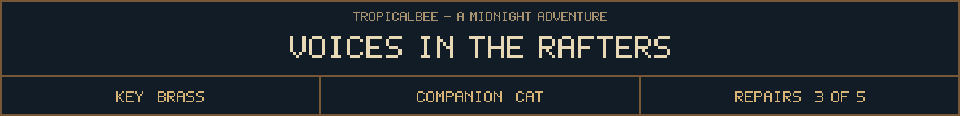
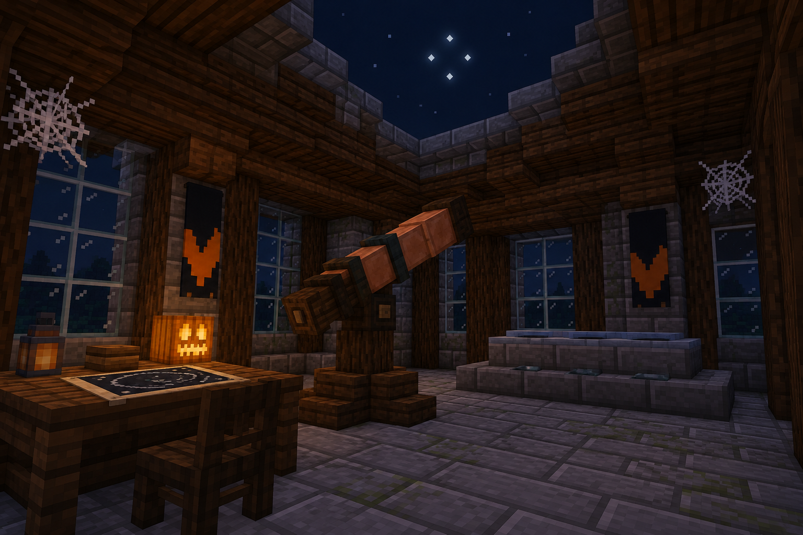

<!-- Generated by source/render-adventure.mjs. Edit source/adventure.mjs or source/adventure-expansion.mjs. -->

<strong>Discovery - she needs an answer to complete the invitation.</strong>

<small><strong>Inventory:</strong> Brass key &middot; Moonseed &middot; Copper coil &middot; Star lantern &middot; Black cat companion</small>

From the front door, children call, &quot;Trick or treat.&quot; One of the voices is your own. You keep your mouth shut.

Elias answers from the attic, over and over: &quot;No one is home.&quot; For the first time, you hear the effort it costs him.

  
  

House map and ward journal

<strong>House:</strong> Foyer &rarr; Study &rarr; Attic &rarr; Garden.

<strong>Beyond the garden:</strong> Greenhouse &rarr; Cellar &rarr; Workshop &rarr; Observatory.

Leave through the garden for a shorter ending, or follow the lanterns to restore the ward and free the stolen names. Backtracking preserves your inventory; Restart starts over.

<ol><li>Briar House steals names every Halloween. Elias left a broken beacon ward; restoring it can release the names.</li><li>Moon water opens the silver flower. Its moonseed reveals things the haunting conceals.</li><li>Pump fuse order: amber before blue, blue before green. The dry cabinet holds the copper coil.</li><li>Lantern circuit: socket receives the seed, gear draws the current, prism sends the light outward.</li></ol>

  <a href="start.md">Restart adventure</a>
  &nbsp;&middot;&nbsp;
  <a href="../../README.md">Return to profile</a>

Progress travels with this page. Bookmark it to resume. Restart begins a new run.

