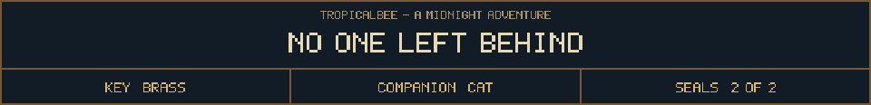
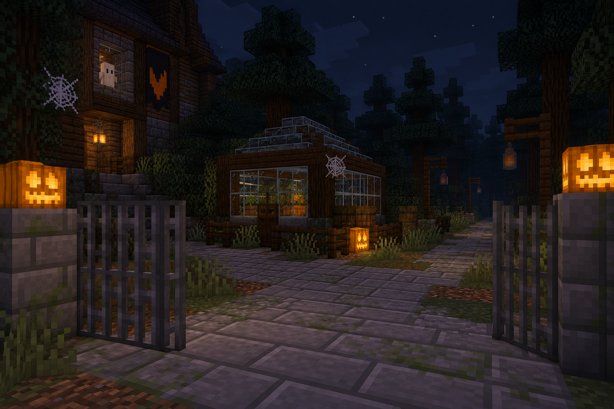

<!-- Generated by source/render-adventure.mjs. Edit source/adventure.mjs or source/adventure-expansion.mjs. -->

<strong>Ending 04 of 06 - The Watcher at the Window</strong>

The cat leads you through the gate without once looking back. At the edge of town, you hear a third set of footsteps stop when yours do.

At home, the cat takes its place at your bedroom window. All night, something outside politely asks to be let in. It uses Elias's voice.

THE WATCHER AT THE WINDOW - You both escaped. The cat keeps the thing outside. Every October 31, you remember to shut the windows before dark.

House map

<strong>House:</strong> Foyer &rarr; Study &rarr; Attic &rarr; Garden.

<strong>Beyond the garden:</strong> Greenhouse &rarr; Cellar &rarr; Workshop &rarr; Observatory.

Leave through the garden for a shorter ending, or follow the lanterns to restore the ward and free the stolen names. Backtracking preserves your inventory; Restart starts over.

Find the brass key and solve the two house locks to reach the garden.

  <a href="start.md">Restart adventure</a>
  &nbsp;&middot;&nbsp;
  <a href="../../README.md">Return to profile</a>
  &nbsp;&middot;&nbsp;
  <a href="endings.md">Ending collection (spoilers)</a>

Progress travels with this page. Bookmark it to resume. Restart begins a new run.

