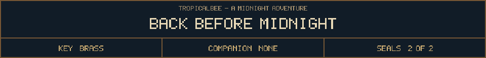

<!-- Generated by source/render-adventure.mjs. Edit source/adventure.mjs or source/adventure-expansion.mjs. -->

<strong>Ending 01 of 06 - The Escape</strong>

You step through the gate. Behind you, the cottage windows brighten and the ghost waves from the attic.

The brass key is yours to keep. On its ribbon, someone has tied a note: &quot;Next time, knock.&quot;

THE ESCAPE - Two seals broken. One very good story. You found your way home.

House map

<strong>House:</strong> Foyer &rarr; Study &rarr; Attic &rarr; Garden.

<strong>Beyond the garden:</strong> Greenhouse &rarr; Cellar &rarr; Workshop &rarr; Observatory.

The garden offers a shorter ending or the longer repair quest. Backtracking choices preserve your current inventory; Restart starts over.

Find the brass key and solve the two house locks to reach the garden.

  <a href="start.md">Restart adventure</a>
  &nbsp;&middot;&nbsp;
  <a href="../../README.md">Return to profile</a>
  &nbsp;&middot;&nbsp;
  <a href="endings.md">Ending collection (spoilers)</a>

Progress travels with this page. Bookmark it to resume. Restart begins a new run.

