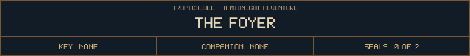
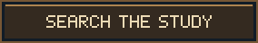

<!-- Generated by source/render-adventure.mjs. Edit source/adventure.mjs or source/adventure-expansion.mjs. -->

<strong>Find the brass key to the attic.</strong>

The front door closes without touching its frame. A staircase leads to a locked attic. To your left, a candle burns in the study. Your muddy footprints continue across the floor several steps ahead of you.

The caretaker calls himself Elias. A black cat hisses at the shadow behind him. Elias has no body solid enough to cast one.

&quot;The study key. Then the autumn bell,&quot; he says. &quot;And whatever you hear outside, do not say trick or treat back.&quot;

  
  
  

House map

<strong>House:</strong> Foyer &rarr; Study &rarr; Attic &rarr; Garden.

<strong>Beyond the garden:</strong> Greenhouse &rarr; Cellar &rarr; Workshop &rarr; Observatory.

Leave through the garden for a shorter ending, or follow the lanterns to restore the ward and free the stolen names. Backtracking preserves your inventory; Restart starts over.

Find the brass key and solve the two house locks to reach the garden.

  <a href="start.md">Restart adventure</a>
  &nbsp;&middot;&nbsp;
  <a href="../../README.md">Return to profile</a>

Progress travels with this page. Bookmark it to resume. Restart begins a new run.

