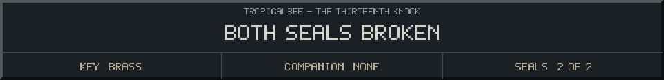

<!-- Generated by source/render-adventure.mjs. Edit source/adventure.mjs or source/adventure-expansion.mjs. -->

<strong>The garden gate is open. Choose your ending.</strong>

The leaf bell rings. Outside, the carved mouths fall silent. A narrow stair takes you into the garden, and the iron gate swings open.

You can see the road home. Then a pumpkin beside your shoe whispers, &quot;Please. My name was Ada.&quot; In the attic window, Elias still holds out the cup.

A trail of unlit lanterns leads toward a greenhouse. A note tied to the first post reads: &quot;The gate saves one guest. The beacon can save every name. Five parts remain. - Elias&quot;

  
  
  

House map

<strong>House:</strong> Foyer &rarr; Study &rarr; Attic &rarr; Garden.

<strong>Beyond the garden:</strong> Greenhouse &rarr; Cellar &rarr; Workshop &rarr; Observatory.

Leave through the garden for a shorter ending, or follow the lanterns to restore the ward and free the stolen names. Backtracking preserves your inventory; Restart starts over.

Find the brass key and solve the two house locks to reach the garden.

  <a href="start.md">Restart adventure</a>
  &nbsp;&middot;&nbsp;
  <a href="../../README.md">Return to profile</a>

Progress travels with this page. Bookmark it to resume. Restart begins a new run.

