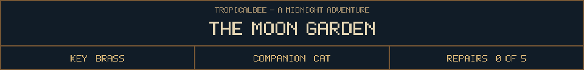
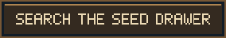

<!-- Generated by source/render-adventure.mjs. Edit source/adventure.mjs or source/adventure-expansion.mjs. -->

<strong>Wake the silver flower without flooding its roots.</strong>

<small><strong>Inventory:</strong> Brass key &middot; Black cat companion</small>

Inside the glass-block greenhouse, a silver flower grows in soil that has never seen daylight. Beyond the panes, carved pumpkin faces turn slowly away from it.

Three valves feed its planter: sun, rain and moon. A botanical notebook lies on the stone shelf. Something taps against the glass when you look down.

Your cat stays beside the silver flower. Its reflection watches a different window.

  
  
  

House map and ward journal

<strong>House:</strong> Foyer &rarr; Study &rarr; Attic &rarr; Garden.

<strong>Beyond the garden:</strong> Greenhouse &rarr; Cellar &rarr; Workshop &rarr; Observatory.

Leave through the garden for a shorter ending, or follow the lanterns to restore the ward and free the stolen names. Backtracking preserves your inventory; Restart starts over.

<ol><li>Briar House steals names every Halloween. Elias left a broken beacon ward; restoring it can release the names.</li></ol>

  <a href="start.md">Restart adventure</a>
  &nbsp;&middot;&nbsp;
  <a href="../../README.md">Return to profile</a>

Progress travels with this page. Bookmark it to resume. Restart begins a new run.

