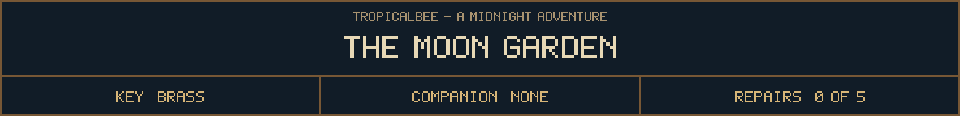

<!-- Generated by source/render-adventure.mjs. Edit source/adventure.mjs or source/adventure-expansion.mjs. -->

<strong>Wake the silver flower without flooding its roots.</strong>

<small><strong>Inventory:</strong> Brass key</small>

The greenhouse smells of wet clay. Under a glass dome, a silver flower keeps its last seed tucked out of reach.

Three valves feed its planter: sun, rain and moon. A botanical notebook lies on the stone shelf.

A drip echoes through the room, patient as a clock.

  
  
  

House map and repair journal

<strong>House:</strong> Foyer &rarr; Study &rarr; Attic &rarr; Garden.

<strong>Beyond the garden:</strong> Greenhouse &rarr; Cellar &rarr; Workshop &rarr; Observatory.

The garden offers a shorter ending or the longer repair quest. Backtracking choices preserve your current inventory; Restart starts over.

<ol><li>The old nightkeeper built a beacon to guide lost travellers. Its light has gone out.</li></ol>

  <a href="start.md">Restart adventure</a>
  &nbsp;&middot;&nbsp;
  <a href="../../README.md">Return to profile</a>

Progress travels with this page. Bookmark it to resume. Restart begins a new run.

