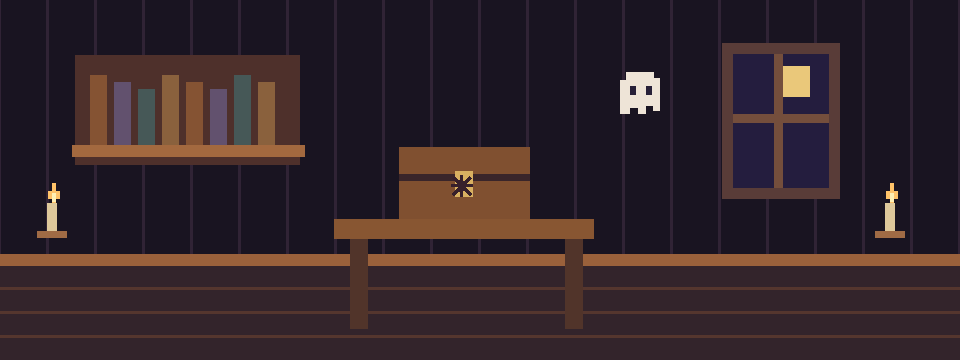

# The Brass Key

The spider symbol turns. Inside the chest is a brass key tied with an orange ribbon. You take it.

Something upstairs unlocks itself with a hopeful little click.

**Carrying:** Brass key

- [Take the key upstairs](attic.md)
- [Return to the foyer](foyer-key.md)
