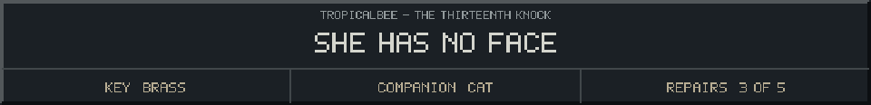
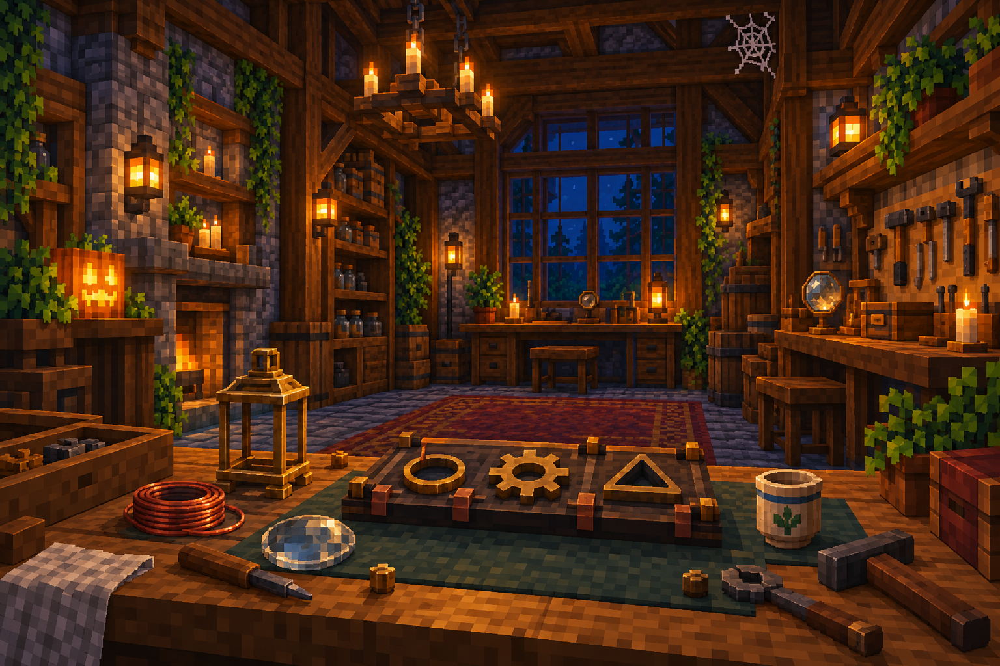

<!-- Generated by source/render-adventure.mjs. Edit source/adventure.mjs or source/adventure-expansion.mjs. -->

<strong>Star lantern assembled. Find its bearing upstairs.</strong>

<small><strong>Inventory:</strong> Brass key &middot; Moonseed &middot; Copper coil &middot; Star lantern &middot; Black cat companion</small>

A thin star of light appears in the glass. The frame warms in your hands. Against all reasonable expectations, it works.

The moonseed and coil are secured inside; you carry them as part of the assembled lantern.

A narrow spiral stair climbs to the observatory. The beacon needs a direction before it can guide anyone.

  
  

House map and repair journal

<strong>House:</strong> Foyer &rarr; Study &rarr; Attic &rarr; Garden.

<strong>Beyond the garden:</strong> Greenhouse &rarr; Cellar &rarr; Workshop &rarr; Observatory.

The garden offers a shorter ending or the longer repair quest. Backtracking choices preserve your current inventory; Restart starts over.

<ol><li>The old nightkeeper built a beacon to guide lost travellers. Its light has gone out.</li><li>The silver flower opens only to water that has caught moonlight. Its moonseed stores that light.</li><li>Pump fuse order: amber before blue, blue before green. The dry cabinet holds the copper coil.</li><li>Lantern circuit: socket receives the seed, gear draws the current, prism sends the light outward.</li></ol>

  <a href="start.md">Restart adventure</a>
  &nbsp;&middot;&nbsp;
  <a href="../../README.md">Return to profile</a>

Progress travels with this page. Bookmark it to resume. Restart begins a new run.

