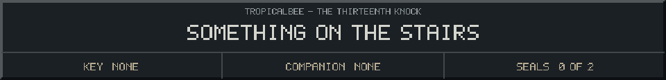

<!-- Generated by source/render-adventure.mjs. Edit source/adventure.mjs or source/adventure-expansion.mjs. -->

<strong>Find the brass key to the attic.</strong>

A brass keyhole sits beneath a carved spider. Through the attic door, someone drags a chair into place directly opposite you.

&quot;She cannot cross a locked threshold,&quot; Elias says. &quot;Neither can you. Find the key before she remembers which side you are on.&quot;

  
  

Need a hint?

The key is in the study. The spider on this door is a clue.

House map

<strong>House:</strong> Foyer &rarr; Study &rarr; Attic &rarr; Garden.

<strong>Beyond the garden:</strong> Greenhouse &rarr; Cellar &rarr; Workshop &rarr; Observatory.

Leave through the garden for a shorter ending, or follow the lanterns to restore the ward and free the stolen names. Backtracking preserves your inventory; Restart starts over.

Find the brass key and solve the two house locks to reach the garden.

  <a href="start.md">Restart adventure</a>
  &nbsp;&middot;&nbsp;
  <a href="../../README.md">Return to profile</a>

Progress travels with this page. Bookmark it to resume. Restart begins a new run.

