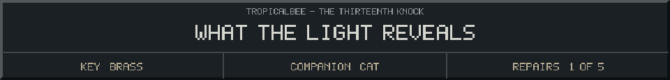

<!-- Generated by source/render-adventure.mjs. Edit source/adventure.mjs or source/adventure-expansion.mjs. -->

<strong>Moonseed collected. Recover the copper coil below.</strong>

<small><strong>Inventory:</strong> Brass key &middot; Moonseed &middot; Black cat companion</small>

Moon water reaches the roots. The flower opens around a pale seed. When you lift it, every false reflection vanishes at once.

For an instant you see the garden clearly: the pumpkins hold small, frightened lights. Beyond them stands something tall without a face. It backs away from the seed.

A pipe descends into the cellar. Elias's notebook says the copper coil below can carry the seed's light into a protective lantern.

  
  

House map and ward journal

<strong>House:</strong> Foyer &rarr; Study &rarr; Attic &rarr; Garden.

<strong>Beyond the garden:</strong> Greenhouse &rarr; Cellar &rarr; Workshop &rarr; Observatory.

Leave through the garden for a shorter ending, or follow the lanterns to restore the ward and free the stolen names. Backtracking preserves your inventory; Restart starts over.

<ol><li>Briar House steals names every Halloween. Elias left a broken beacon ward; restoring it can release the names.</li><li>Moon water opens the silver flower. Its moonseed reveals things the haunting conceals.</li></ol>

  <a href="start.md">Restart adventure</a>
  &nbsp;&middot;&nbsp;
  <a href="../../README.md">Return to profile</a>

Progress travels with this page. Bookmark it to resume. Restart begins a new run.

