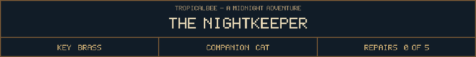

<!-- Generated by source/render-adventure.mjs. Edit source/adventure.mjs or source/adventure-expansion.mjs. -->

<strong>Discovery - why the house appears on Halloween.</strong>

<small><strong>Inventory:</strong> Brass key &middot; Black cat companion</small>

Beneath the notice is an older warning: &quot;On All Hallows' Eve, the boundary thins. Mother Hollow may knock twelve times. A living invitation gives her the thirteenth.&quot;

&quot;She keeps her guests by taking their names. Do not answer her call. Do not eat at her table. A jack-o'-lantern is a face she has already borrowed.&quot;

Elias has written across the bottom: &quot;My beacon held the threshold. I let it fail. The key protects your name while you repair it, unless you willingly give it away.&quot;

  
  

House map and ward journal

<strong>House:</strong> Foyer &rarr; Study &rarr; Attic &rarr; Garden.

<strong>Beyond the garden:</strong> Greenhouse &rarr; Cellar &rarr; Workshop &rarr; Observatory.

Leave through the garden for a shorter ending, or follow the lanterns to restore the ward and free the stolen names. Backtracking preserves your inventory; Restart starts over.

<ol><li>Briar House steals names every Halloween. Elias left a broken beacon ward; restoring it can release the names.</li></ol>

  <a href="start.md">Restart adventure</a>
  &nbsp;&middot;&nbsp;
  <a href="../../README.md">Return to profile</a>

Progress travels with this page. Bookmark it to resume. Restart begins a new run.

