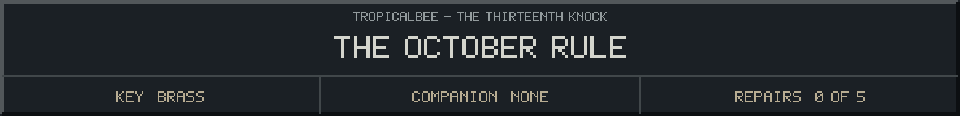
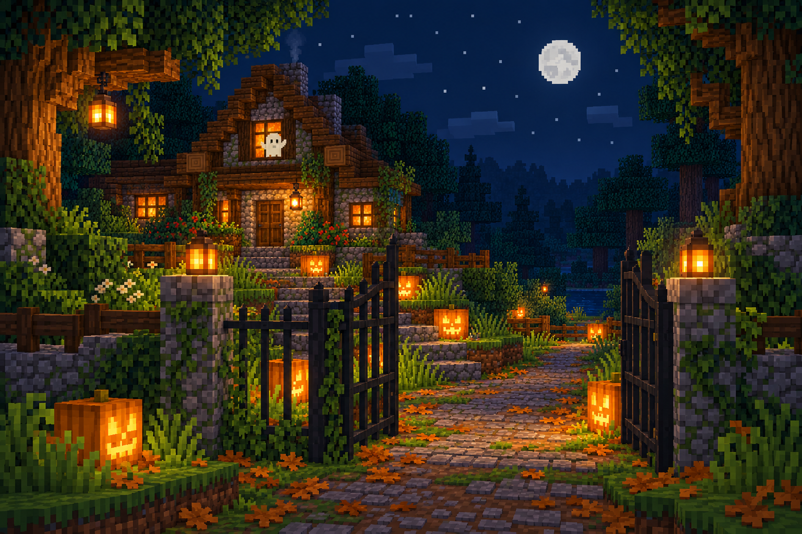

<!-- Generated by source/render-adventure.mjs. Edit source/adventure.mjs or source/adventure-expansion.mjs. -->

<strong>Discovery - a promise left unfinished.</strong>

<small><strong>Inventory:</strong> Brass key</small>

The notice is pinned beneath the brass star: &quot;No one should have to find their way through these trees alone.&quot;

The nightkeeper left for one final journey and never returned. The ghost has been waiting ever since.

Below the promise is a practical list: a living light, a steady current, a lens, a bearing. Someone expected this to be repairable.

  
  

House map and repair journal

<strong>House:</strong> Foyer &rarr; Study &rarr; Attic &rarr; Garden.

<strong>Beyond the garden:</strong> Greenhouse &rarr; Cellar &rarr; Workshop &rarr; Observatory.

The garden offers a shorter ending or the longer repair quest. Backtracking choices preserve your current inventory; Restart starts over.

<ol><li>The old nightkeeper built a beacon to guide lost travellers. Its light has gone out.</li></ol>

  <a href="start.md">Restart adventure</a>
  &nbsp;&middot;&nbsp;
  <a href="../../README.md">Return to profile</a>

Progress travels with this page. Bookmark it to resume. Restart begins a new run.

