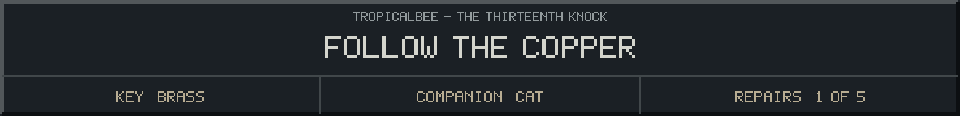

<!-- Generated by source/render-adventure.mjs. Edit source/adventure.mjs or source/adventure-expansion.mjs. -->

<strong>Clue - the pump circuit has an order.</strong>

<small><strong>Inventory:</strong> Brass key &middot; Moonseed &middot; Black cat companion</small>

A maintenance note is wrapped around the pipe: &quot;Amber wakes before blue. Blue wakes before green. Let the current follow the sunrise into the sea, then into the leaves.&quot;

Three small paint spots mark the note in the same order. You keep the sequence in mind as the pipe disappears down the steps.

  
  

House map and repair journal

<strong>House:</strong> Foyer &rarr; Study &rarr; Attic &rarr; Garden.

<strong>Beyond the garden:</strong> Greenhouse &rarr; Cellar &rarr; Workshop &rarr; Observatory.

The garden offers a shorter ending or the longer repair quest. Backtracking choices preserve your current inventory; Restart starts over.

<ol><li>The old nightkeeper built a beacon to guide lost travellers. Its light has gone out.</li><li>The silver flower opens only to water that has caught moonlight. Its moonseed stores that light.</li></ol>

  <a href="start.md">Restart adventure</a>
  &nbsp;&middot;&nbsp;
  <a href="../../README.md">Return to profile</a>

Progress travels with this page. Bookmark it to resume. Restart begins a new run.

