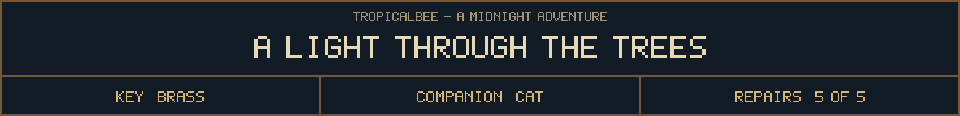

<!-- Generated by source/render-adventure.mjs. Edit source/adventure.mjs or source/adventure-expansion.mjs. -->

<strong>The ward is restored. Leave with the names, or keep the threshold.</strong>

<small><strong>Inventory:</strong> Brass key &middot; Moonseed &middot; Copper coil &middot; Star lantern &middot; Sky bearing &middot; Beacon restored &middot; Black cat companion</small>

Seed. Coil. Lantern. The beam strikes the northern path. Every pumpkin goes dark; small lights rise from their mouths and gather beyond the gate.

A hand presses against the outside of the window. With no face left to borrow, Mother Hollow slips between the trees. The thirteenth knock never comes.

Elias reaches the stair, his own voice at last. &quot;Ada?&quot; One small light waits for him. Before joining it, he tells you the ward will need a keeper when next Halloween comes.

  
  

House map and ward journal

<strong>House:</strong> Foyer &rarr; Study &rarr; Attic &rarr; Garden.

<strong>Beyond the garden:</strong> Greenhouse &rarr; Cellar &rarr; Workshop &rarr; Observatory.

Leave through the garden for a shorter ending, or follow the lanterns to restore the ward and free the stolen names. Backtracking preserves your inventory; Restart starts over.

<ol><li>Briar House steals names every Halloween. Elias left a broken beacon ward; restoring it can release the names.</li><li>Moon water opens the silver flower. Its moonseed reveals things the haunting conceals.</li><li>Pump fuse order: amber before blue, blue before green. The dry cabinet holds the copper coil.</li><li>Lantern circuit: socket receives the seed, gear draws the current, prism sends the light outward.</li><li>The four-star diamond points north. The observatory bearing is now recorded.</li><li>Beacon sequence: seed, coil, lantern. The restored ward releases the names and holds the October threshold shut.</li></ol>

  <a href="start.md">Restart adventure</a>
  &nbsp;&middot;&nbsp;
  <a href="../../README.md">Return to profile</a>

Progress travels with this page. Bookmark it to resume. Restart begins a new run.

