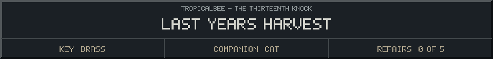
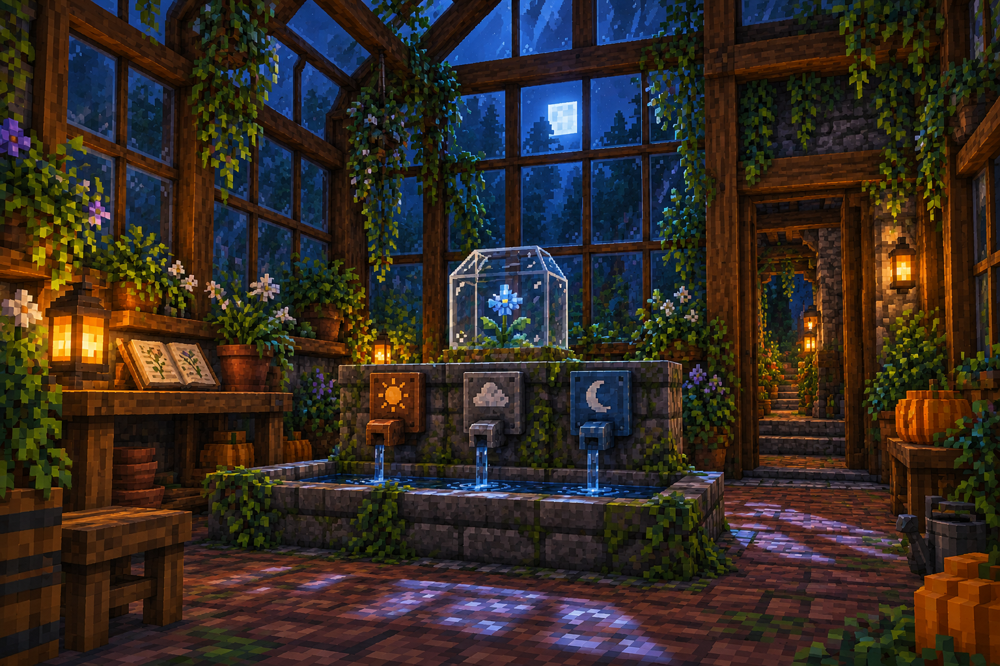

<!-- Generated by source/render-adventure.mjs. Edit source/adventure.mjs or source/adventure-expansion.mjs. -->

<strong>Discovery - the garden remembers its keeper.</strong>

<small><strong>Inventory:</strong> Brass key &middot; Black cat companion</small>

Every empty seed packet has been folded into a little boat. A whole paper fleet rests in the drawer.

On the bottom is one plain sentence: &quot;Plant something even when you are not sure you will see it grow.&quot;

You close the drawer gently. The silver flower is the only living light left in the room.

  
  

House map and repair journal

<strong>House:</strong> Foyer &rarr; Study &rarr; Attic &rarr; Garden.

<strong>Beyond the garden:</strong> Greenhouse &rarr; Cellar &rarr; Workshop &rarr; Observatory.

The garden offers a shorter ending or the longer repair quest. Backtracking choices preserve your current inventory; Restart starts over.

<ol><li>The old nightkeeper built a beacon to guide lost travellers. Its light has gone out.</li></ol>

  <a href="start.md">Restart adventure</a>
  &nbsp;&middot;&nbsp;
  <a href="../../README.md">Return to profile</a>

Progress travels with this page. Bookmark it to resume. Restart begins a new run.

