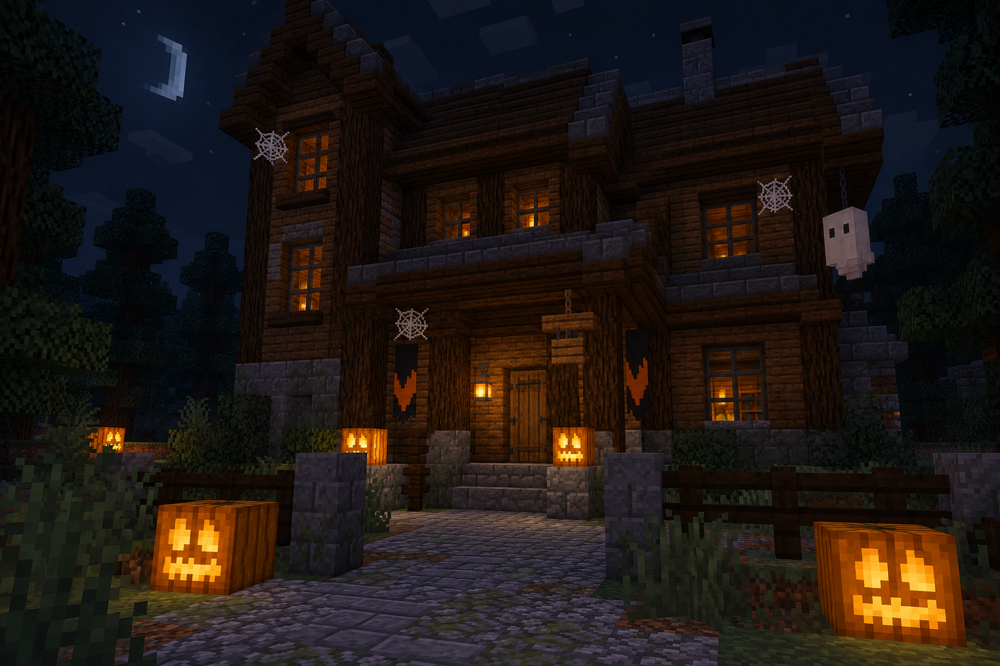

<!-- Generated by source/render-adventure.mjs. Edit source/adventure.mjs or source/adventure-expansion.mjs. -->

<strong>October 31. Briar House has opened its door again.</strong>

You were following the last trick-or-treaters when their costumes vanished between the trees. Only their paper candy bags remained. Ahead, a house stands on a plot that was empty yesterday.

Something knocks from inside the front door. Twelve times. A pale caretaker opens it before the thirteenth. &quot;Come in before she counts you,&quot; he whispers. Behind you, the gate locks.

Every jack-o'-lantern turns toward the sound of your breathing. One mouths your name. You have not told anyone here your name.

A Halloween horror adventure in two chapters, with seven puzzles and six endings. Choose the stone buttons to explore. There is no real-time countdown; wrong answers allow retries, and bookmarking a page saves your place.

  

House map

<strong>House:</strong> Foyer &rarr; Study &rarr; Attic &rarr; Garden.

<strong>Beyond the garden:</strong> Greenhouse &rarr; Cellar &rarr; Workshop &rarr; Observatory.

Leave through the garden for a shorter ending, or follow the lanterns to restore the ward and free the stolen names. Backtracking preserves your inventory; Restart starts over.

Find the brass key and solve the two house locks to reach the garden.

  <a href="start.md">Restart adventure</a>
  &nbsp;&middot;&nbsp;
  <a href="../../README.md">Return to profile</a>

Progress travels with this page. Bookmark it to resume. Restart begins a new run.

