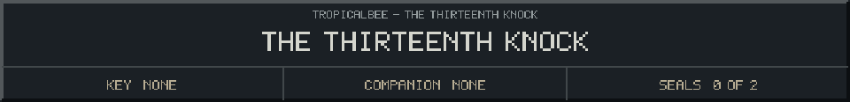
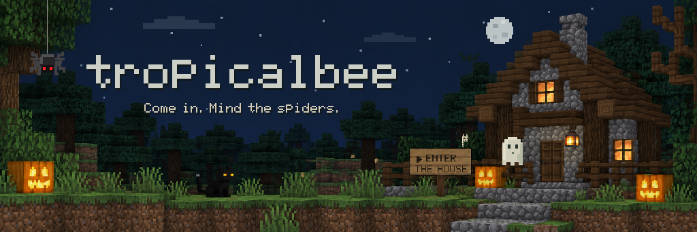

<!-- Generated by source/render-adventure.mjs. Edit source/adventure.mjs or source/adventure-expansion.mjs. -->

<strong>Find the way out. Or a reason to stay.</strong>

You followed a light through the trees. Now a ghost is holding the door open, and the garden gate has clicked shut behind you.

&quot;Two little locks,&quot; it says. &quot;One key, one song. You can leave whenever you solve them. Tea is entirely optional.&quot;

Two chapters, seven puzzles and six endings. Escape the house for a shorter adventure, or follow the unlit lanterns beyond the garden to discover the nightkeeper's story.

Choose the wooden buttons to explore. There is no timer, wrong answers are recoverable, and you can bookmark any page to resume later.

  

House map

<strong>House:</strong> Foyer &rarr; Study &rarr; Attic &rarr; Garden.

<strong>Beyond the garden:</strong> Greenhouse &rarr; Cellar &rarr; Workshop &rarr; Observatory.

The garden offers a shorter ending or the longer repair quest. Backtracking choices preserve your current inventory; Restart starts over.

Find the brass key and solve the two house locks to reach the garden.

  <a href="start.md">Restart adventure</a>
  &nbsp;&middot;&nbsp;
  <a href="../../README.md">Return to profile</a>

Progress travels with this page. Bookmark it to resume. Restart begins a new run.

