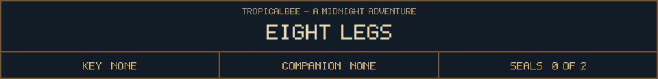

<!-- Generated by source/render-adventure.mjs. Edit source/adventure.mjs or source/adventure-expansion.mjs. -->

<strong>Open the chest. Choose its correct symbol.</strong>

A small chest has three symbols on its lock: a moon, a pumpkin and a spider. The lid will not lift.

The note beside it reads: &quot;No wings to fly. No flame to light. Eight legs keep the brass key tight.&quot;

Which symbol do you press?

  
  
  

Need a hint?

Count the legs in the note. Only one of the three symbols has eight.

House map

<strong>House:</strong> Foyer &rarr; Study &rarr; Attic &rarr; Garden.

<strong>Beyond the garden:</strong> Greenhouse &rarr; Cellar &rarr; Workshop &rarr; Observatory.

The garden offers a shorter ending or the longer repair quest. Backtracking choices preserve your current inventory; Restart starts over.

Find the brass key and solve the two house locks to reach the garden.

  <a href="start.md">Restart adventure</a>
  &nbsp;&middot;&nbsp;
  <a href="../../README.md">Return to profile</a>

Progress travels with this page. Bookmark it to resume. Restart begins a new run.

