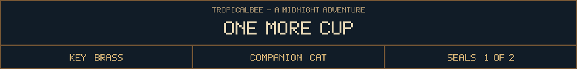
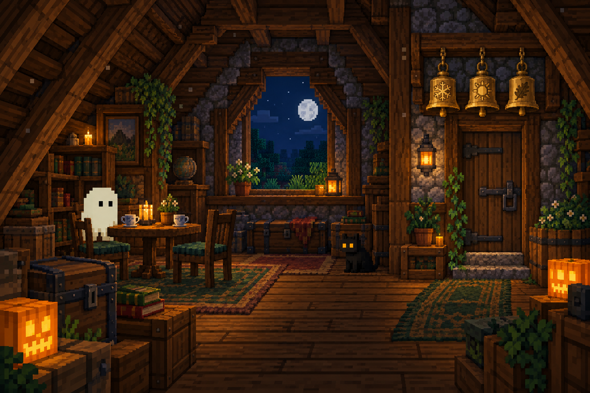

<!-- Generated by source/render-adventure.mjs. Edit source/adventure.mjs or source/adventure-expansion.mjs. -->

<strong>Ending 02 of 06 - The Resident</strong>

You set the brass key beside your cup. The last lock can wait.

The tea tastes of cinnamon. Your cat curls up beside you. By the second cup, your feet no longer quite touch the floor.

&quot;The garage has room for another desk,&quot; says the ghost.

THE RESIDENT - You came looking for a way out. You found a place to build something.

House map

<strong>House:</strong> Foyer &rarr; Study &rarr; Attic &rarr; Garden.

<strong>Beyond the garden:</strong> Greenhouse &rarr; Cellar &rarr; Workshop &rarr; Observatory.

The garden offers a shorter ending or the longer repair quest. Backtracking choices preserve your current inventory; Restart starts over.

Find the brass key and solve the two house locks to reach the garden.

  <a href="start.md">Restart adventure</a>
  &nbsp;&middot;&nbsp;
  <a href="../../README.md">Return to profile</a>
  &nbsp;&middot;&nbsp;
  <a href="endings.md">Ending collection (spoilers)</a>

Progress travels with this page. Bookmark it to resume. Restart begins a new run.

