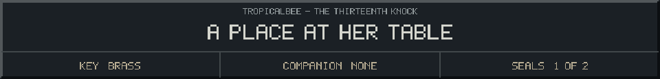
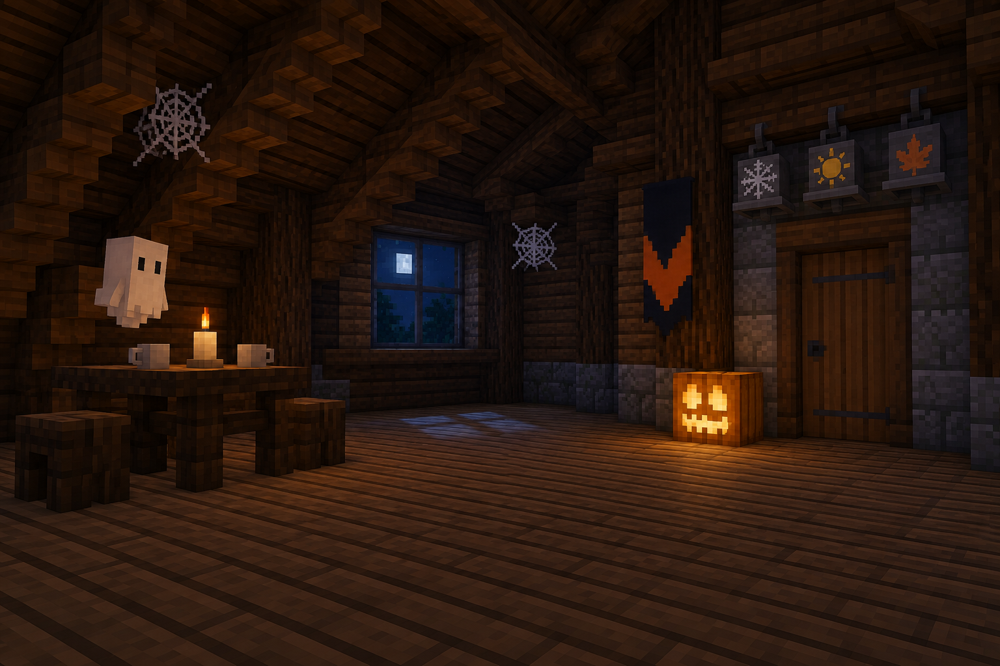

<!-- Generated by source/render-adventure.mjs. Edit source/adventure.mjs or source/adventure-expansion.mjs. -->

<strong>Ending 02 of 06 - The Empty Costume</strong>

You set the key beside your cup. Elias mouths a warning, but a different voice comes out: &quot;Drink.&quot;

The tea tastes of burnt sugar. You try to say your name and find an empty space where the word should be.

On the chair lies your Halloween coat, still shaped around someone who is no longer there. A new pumpkin lights up in the garden.

THE EMPTY COSTUME - When the next visitor arrives, your voice will join the others asking to be taken home.

House map

<strong>House:</strong> Foyer &rarr; Study &rarr; Attic &rarr; Garden.

<strong>Beyond the garden:</strong> Greenhouse &rarr; Cellar &rarr; Workshop &rarr; Observatory.

Leave through the garden for a shorter ending, or follow the lanterns to restore the ward and free the stolen names. Backtracking preserves your inventory; Restart starts over.

Find the brass key and solve the two house locks to reach the garden.

  <a href="start.md">Restart adventure</a>
  &nbsp;&middot;&nbsp;
  <a href="../../README.md">Return to profile</a>
  &nbsp;&middot;&nbsp;
  <a href="endings.md">Ending collection (spoilers)</a>

Progress travels with this page. Bookmark it to resume. Restart begins a new run.

