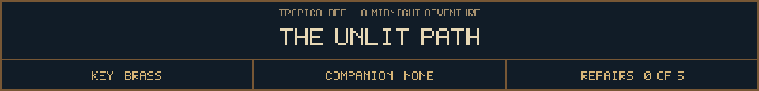

<!-- Generated by source/render-adventure.mjs. Edit source/adventure.mjs or source/adventure-expansion.mjs. -->

<strong>Chapter two - restore the ward and free the stolen names.</strong>

<small><strong>Inventory:</strong> Brass key</small>

You leave the open gate behind. As you pass each pumpkin, it whispers a different name. Ada. Thomas. Nell. Some voices sound very old. None remember leaving this garden.

Elias calls from the window, &quot;I built a light to send them home. She put it out.&quot; Another voice speaks through him: &quot;Such a helpful guest.&quot;

Between the trees hangs a white Halloween mask. When you blink, it is one trunk closer.

His note lists five parts of the ward: moonseed, copper coil, star lantern, northern bearing, beacon. The house has kept them apart. You still have the brass key.

  
  
  

House map and ward journal

<strong>House:</strong> Foyer &rarr; Study &rarr; Attic &rarr; Garden.

<strong>Beyond the garden:</strong> Greenhouse &rarr; Cellar &rarr; Workshop &rarr; Observatory.

Leave through the garden for a shorter ending, or follow the lanterns to restore the ward and free the stolen names. Backtracking preserves your inventory; Restart starts over.

<ol><li>Briar House steals names every Halloween. Elias left a broken beacon ward; restoring it can release the names.</li></ol>

  <a href="start.md">Restart adventure</a>
  &nbsp;&middot;&nbsp;
  <a href="../../README.md">Return to profile</a>

Progress travels with this page. Bookmark it to resume. Restart begins a new run.

