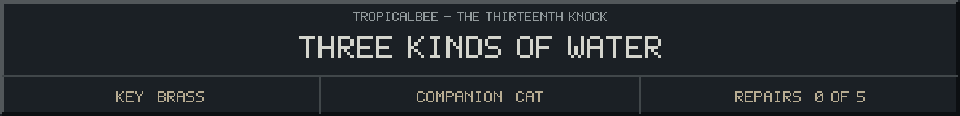
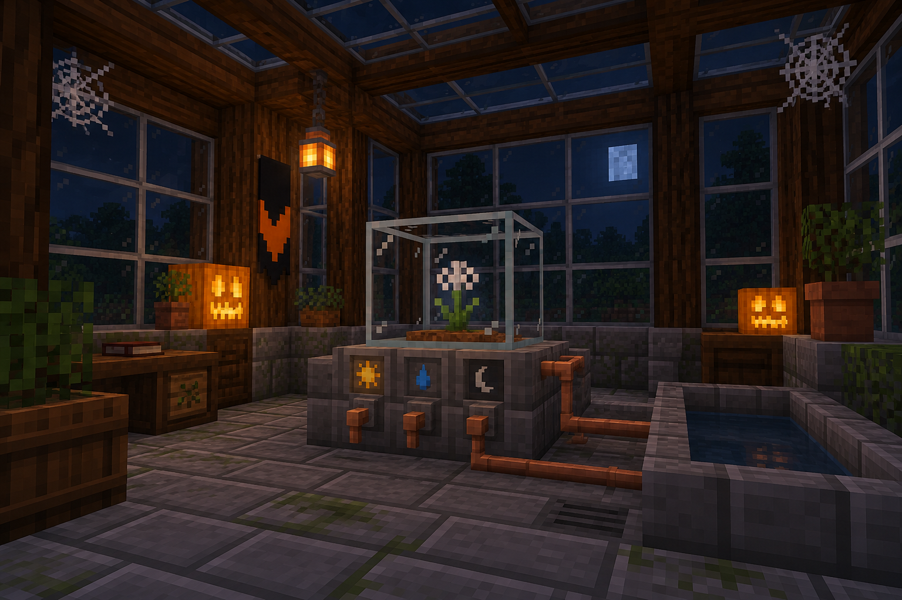

<!-- Generated by source/render-adventure.mjs. Edit source/adventure.mjs or source/adventure-expansion.mjs. -->

<strong>Puzzle 03 - choose one irrigation valve.</strong>

<small><strong>Inventory:</strong> Brass key &middot; Black cat companion</small>

The three handles resist, then loosen. Outside, a borrowed voice asks what you are growing. You do not answer.

Sun warms the pumpkins. Rain feeds the ferns. Moon catches the night in a shallow trough. Which belongs to the silver flower?

  
  
  

Need a hint?

The botanical note points to the crescent-marked trough. Choose the moon valve.

House map and ward journal

<strong>House:</strong> Foyer &rarr; Study &rarr; Attic &rarr; Garden.

<strong>Beyond the garden:</strong> Greenhouse &rarr; Cellar &rarr; Workshop &rarr; Observatory.

Leave through the garden for a shorter ending, or follow the lanterns to restore the ward and free the stolen names. Backtracking preserves your inventory; Restart starts over.

<ol><li>Briar House steals names every Halloween. Elias left a broken beacon ward; restoring it can release the names.</li></ol>

  <a href="start.md">Restart adventure</a>
  &nbsp;&middot;&nbsp;
  <a href="../../README.md">Return to profile</a>

Progress travels with this page. Bookmark it to resume. Restart begins a new run.

